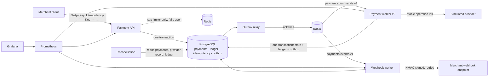
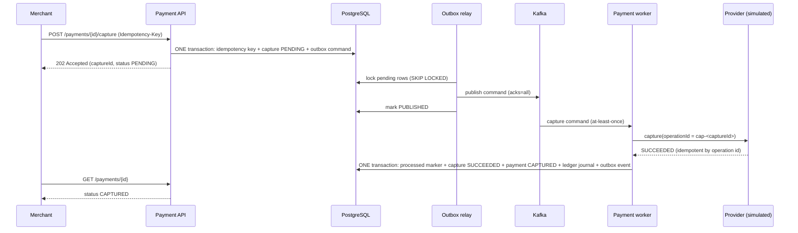

# PayCore: Distributed Payment Processing Engine

An event-driven payment engine built around the parts of payments that are hard to get right: **money that is always exact, requests that
can be retried safely, a double-entry ledger that cannot be unbalanced, and recovery from crashes without losing or duplicating financial effects.**

> **PayCore is a financial-systems simulation. It is not a payment processor, not PCI DSS compliant, and not certified for live payments.**
> It uses synthetic customer ids and a deterministic *simulated* provider. It never handles real card data and never contacts a bank or payment network.

Everything stated below was run and checked; see [Verified results](#verified-results) and [Not implemented / unverified](#not-implemented--unverified).

## Architecture



One codebase and one container image run in three **roles** (`ROLE_API`, `ROLE_WORKER`, `ROLE_WEBHOOK`): the payment API, the payment processing worker (scaled to 2 replicas) and the webhook /
reconciliation worker. PostgreSQL is the system of record; Kafka carries events; Redis is optional and never holds financial truth.

| Topic | Key | Purpose |
|---|---|---|
| `payments.commands.v1` | paymentId | authorize / capture / refund commands for the worker |
| `payments.events.v1` | paymentId | payment lifecycle events (feeds webhooks) |
| `payments.dlq.v1` | | dead letters (invalid or exhausted messages) |
| `webhooks.events.v1`, `reconciliation.events.v1` | | created for future consumers; reconciliation publishes `reconciliation.completed` |

## Payment lifecycle

```
CREATED --authorize--> PROCESSING --provider ok--> AUTHORIZED --capture--> CAPTURED
                           |                           |
                           +--provider decline--> FAILED   +--cancel--> CANCELED
```

Transitions are enforced in the application **and** by a PostgreSQL trigger. A capture is requested while the payment stays AUTHORIZED; its own state (PENDING, SUCCEEDED, FAILED) is shown as
`captureStatus`. Refunds have their own lifecycle (PENDING, SUCCEEDED, FAILED). Authorize, capture and refund return **HTTP 202** with the *current* state: the API never claims a final result
before the worker has produced it.



```mermaid
sequenceDiagram
  participant W as Payment worker
  participant P as Provider
  participant D as PostgreSQL
  participant K as Kafka
  W->>P: capture(op-1)
  P->>P: records SUCCEEDED
  P--xW: response lost (timeout)
  W->>P: lookup(op-1)
  P-->>W: SUCCEEDED
  Note over W: outcome is known: NO second capture call
  W->>D: apply result in one transaction
  Note over K,W: if the worker is killed before commit, Kafka redelivers;<br/>state guards, processed markers and the unique ledger reference make the replay a no-op
```

## Key design

- **Exact money.** Integer minor units (USD cents, scale 2) in `bigint`; no float or double anywhere; overflow-checked arithmetic; the API accepts integers only. `12.5` or `"100"` are rejected (a test found Jackson silently truncating `12.5` to `12`, now fixed). USD only.
- **Idempotency** ([ADR 0003](docs/decisions/0003-idempotency-enforcement.md)). Keys scoped per merchant and operation, canonical-JSON SHA-256 fingerprint, stored in PostgreSQL in the *same transaction* as the effect. Same key and payload replays the original response
  (`Idempotent-Replayed: true`); same key with a different payload is **409**. A crash or rollback leaves no key, so the retry runs cleanly.
- **Double-entry ledger** ([ADR 0004](docs/decisions/0004-double-entry-ledger.md)). Capture: debit settlement clearing, credit merchant payable. Refund: the reverse. Journals are balanced per currency by a deferred database trigger, rows are immutable, a capture/refund posts once (unique reference),
  and corrections are reversing journals, never edits. Balances are derived from entries.
- **Transactional outbox** ([ADR 0002](docs/decisions/0002-transactional-outbox.md)). Events are written with the state change and relayed to Kafka; several relays cooperate with `SKIP LOCKED`.
- **Refund ceiling.** `refunded_minor` is reserved with one conditional `UPDATE` and protected by `CHECK (refunded_minor <= captured_minor)`, so concurrent refunds cannot over-refund. A failed refund releases its reservation.
- **One live capture per payment.** Partial unique index; concurrent captures produce exactly one winner.
- **Ambiguous provider outcomes.** The provider is idempotent by operation id and has a status lookup. After a timeout the worker looks up the truth first and retries only if nothing was recorded, always with the same id.

### Delivery guarantees (precise)
Kafka delivery is **at-least-once**, and **end-to-end exactly-once is not claimed**. Duplicates are made harmless: processed-event markers in the same transaction as effects, conditional state updates, unique ledger references, stable provider operation ids.
Webhooks are at-least-once too: receivers de-duplicate on the stable `PayCore-Event-Id`. Ordering is per payment (key = paymentId) within a partition; handlers do not depend on cross-payment order. See [ADR 0005](docs/decisions/0005-kafka-delivery-guarantees.md).

## Simulated provider scenarios
Chosen deterministically by `customerId`: `cust_decline`, `cust_capture_fail`, `cust_refund_fail`, `cust_unavailable` (first 2 calls fail), `cust_timeout_no_effect`, `cust_timeout_after_success` (ambiguous), `cust_delayed`, `cust_duplicate_callback`; anything else succeeds.

## Webhooks
Endpoint registration with event-type subscriptions, HMAC-SHA256 signatures (`PayCore-Signature: t=<ts>,v1=<hex>`), exponential backoff (bounded, then DEAD), attempt history, and replay of dead deliveries. **SSRF policy:** only allowlisted hosts by default; an optional mode accepts other hosts only if they resolve exclusively to public addresses
(blocks loopback, link-local/cloud metadata, private ranges, CGNAT, IPv6 ULA); redirects are never followed; the check is repeated at delivery time. Not implemented: pinning the connection to the validated IP (needed against DNS rebinding in production), and an egress proxy. A local test receiver (`/internal/test-receiver`, development only) verifies signatures.

## Reconciliation
`POST /api/v1/reconciliation/runs` (admin) compares payments, captures/refunds, the provider's own record and the ledger and stores real discrepancies: missing or mismatched journals, duplicate journals, captured/refunded amount mismatches, orphan journals, provider outcome mismatches, and stuck work.
`?repair=true` is deliberately narrow: it only re-queues the original command for stuck work (safe, because handlers are idempotent). It never edits amounts or ledger rows. It also runs on a schedule in the webhook worker. Tests inject each inconsistency with raw SQL and assert it is found.

## Security model
API-key authentication (only a SHA-256 hash is stored; the key is shown once); merchant-scoped authorization where another merchant's resource is a **404** (never 403); a separate admin key for operator endpoints; request validation, 64 KB body limit, whitelisted sort fields and bound parameters only (no SQL injection surface);
a Redis rate limiter that fails open; an audit log with correlation ids; management endpoints (health, metrics) on a separate port; no secrets in the repository (`ADMIN_KEY` has no default in the application; Compose supplies development-only values). Known gaps: no key rotation, no mTLS, no TLS termination here,
the webhook secret is stored in plaintext (production should use a KMS), and the database user is not least-privilege.

## Quick start
Prerequisites: Docker with Compose v2 and about 6 GB of memory for Docker (the stack measured about 2.5 GB).

```bash
docker compose up --build -d
```

| What | URL |
|---|---|
| API | http://localhost:8080/api/v1 |
| Swagger UI / OpenAPI | http://localhost:8080/api/v1/docs, http://localhost:8080/api/v1/openapi |
| Health, metrics (management port) | http://localhost:8081/actuator/health/readiness, `/actuator/prometheus` |
| Grafana ("PayCore Overview") | http://localhost:3000 (`admin` / `admin-dev`, development only) |
| Prometheus | http://localhost:9090 |

```bash
A=http://localhost:8080
# 1. create a merchant (operator key; the API key is shown once)
KEY=$(curl -s -X POST $A/api/v1/merchants -H "X-Admin-Key: dev-only-admin-key-change-me" -H 'Content-Type: application/json' -d '{"name":"Acme"}' | python3 -c "import sys,json;print(json.load(sys.stdin)['apiKey'])")
# 2. create a payment ($25.00 = 2500 minor units)
P=$(curl -s -X POST $A/api/v1/payments -H "X-Api-Key: $KEY" -H "Idempotency-Key: demo-1" -H 'Content-Type: application/json' -d '{"amountMinor":2500,"currency":"USD","customerId":"cust_demo"}' | python3 -c "import sys,json;print(json.load(sys.stdin)['id'])")
# 3. authorize, then capture (both asynchronous: 202)
curl -s -X POST $A/api/v1/payments/$P/authorize -H "X-Api-Key: $KEY"
curl -s -X POST $A/api/v1/payments/$P/capture -H "X-Api-Key: $KEY" -H "Idempotency-Key: demo-cap-1" -H 'Content-Type: application/json' -d '{}'
# 4. poll until CAPTURED, then refund part of it
curl -s $A/api/v1/payments/$P -H "X-Api-Key: $KEY"
curl -s -X POST $A/api/v1/payments/$P/refunds -H "X-Api-Key: $KEY" -H "Idempotency-Key: demo-ref-1" -H 'Content-Type: application/json' -d '{"amountMinor":1000}'
# 5. ledger-derived balance owed to the merchant, and a reconciliation run
curl -s $A/api/v1/ledger/balance -H "X-Api-Key: $KEY"
curl -s -X POST $A/api/v1/reconciliation/runs -H "X-Admin-Key: dev-only-admin-key-change-me"
```

Webhook demo: register `http://payment-api:8080/internal/test-receiver` (allowlisted host) with `POST /api/v1/webhooks/endpoints` and `{"eventTypes":["*"]}`, then run a payment.

Stop (add `-v` to delete all data):

```bash
docker compose down
```

## API
`POST/GET /api/v1/payments`, `GET /payments/{id}`, `POST /payments/{id}/authorize|capture|cancel|refunds`, `GET /payments/{id}/refunds`, `GET /transactions`, `GET /ledger/journals/{id}`, `GET /ledger/balance`,
`POST/GET /webhooks/endpoints`, `GET /webhooks/deliveries`, `POST /webhooks/deliveries/{id}/replay`, `POST /merchants` (admin), `POST|GET /reconciliation/runs[/{id}]` (admin).
Errors share one schema (`code`, `message`, `details`); 400 invalid, 401 no/invalid key, 404 unknown or another merchant's, 409 conflict, 422 business rule, 429 rate limited, 503 dependency down (with `Retry-After`). Full spec at `/api/v1/openapi`.

## Running the tests
```bash
export JAVA_HOME=$(/usr/libexec/java_home -v 21)
docker compose up -d postgres kafka redis       # integration tests use a separate paycore_test database and unique Kafka topics
(cd app && mvn -B verify)                        # 8 unit + 73 integration tests
tests/chaos/chaos.sh all                         # failure/recovery scenarios against the running compose stack
scripts/benchmark.sh light-10 10 30s             # k6 benchmark (also moderate-50, heavy-100, stress-200)
scripts/bulk.sh 10000 50                         # optional 10,000-payment run
```
If your Postgres volume predates the test database: `docker compose exec postgres psql -U paycore -d paycore -c "CREATE DATABASE paycore_test"`.

## Verified results

Environment: Apple M3 Pro, 18 GB RAM; containers run in a 4-CPU / 8.7 GB Colima VM (k6, PostgreSQL, Kafka and all services share it). Numbers are measurements on that machine, not capacity claims.

### Tests: 81 passing (8 unit, 73 integration)
Integration tests run against real PostgreSQL 16, Kafka and Redis with a real HTTP server (no mocks of those). They cover:
- **Database invariants attacked with raw SQL** (10 tests): unbalanced or single-entry journals cannot commit, ledger rows reject UPDATE/DELETE/TRUNCATE, a capture/refund can post only once, refunds can never exceed captured, invalid state transitions are rejected, one live capture per payment.
- **Idempotency** (11): same key and payload replays, different payload is 409, 16 simultaneous identical requests produce exactly one payment, simultaneous conflicting requests produce exactly one winner, a rolled-back transaction leaves no key, expiry behaviour, 12 simultaneous captures with different keys produce exactly one capture.
- **Refunds** (8): full, partial, duplicate, over-limit, uncaptured, two and twelve concurrent refunds (never over-refunded), failed refund releases its reservation, ambiguous provider outcome resolved by lookup.
- **Worker resilience** (10): the same Kafka command redelivered 4 times has one financial effect, stale events are harmless, provider timeout after success (no second provider call), timeout with no effect (retried with the same operation id), provider unavailability retried with backoff, failed capture, duplicate provider callback, invalid messages go to the dead-letter topic.
- **Outbox** (3): a publisher crash after the broker ack causes a duplicate event but no loss and one effect; five publishers share 300 events with none published twice; the outbox row is atomic with the state change.
- **Webhooks** (6), **reconciliation** (10: every injected inconsistency detected, safe repair, journal reversal), **security** (7), **rate limiting** (1: with a limit of 5/s, 40 rapid requests get HTTP 429 with `Retry-After: 1`, another merchant is unaffected, the merchant recovers in the next window), an end-to-end flow (5), and a 20-payment ledger concurrency stress test.

**Bugs these tests and the chaos runs found, all fixed:** (1) the balanced-journal trigger referenced a column that does not exist on one of its two tables, so every commit failed; (2) Jackson silently truncated `"amountMinor": 12.5` to `12`;
(3) the outbox relay and webhook worker ran **without a transaction** because `@Scheduled` called `@Transactional` methods on the same object (Spring skips the proxy), so two publishers could take the same rows, a webhook fan-out was not atomic, and scheduled reconciliation was not atomic;
(4) reconciliation read two columns both named `id` into a map and crashed; (5) a database outage returned 401 ("invalid key") instead of 503, because the key check needs the database.

### Failure and recovery tests (`tests/chaos/chaos.sh`, run against the live compose stack)
Each scenario injects a real failure, then checks expected versus observed counts and re-checks the financial invariants for the whole database. Full log: [docs/reliability/chaos-run.log](docs/reliability/chaos-run.log).

| Scenario | Expected | Observed |
|---|---|---|
| A. `kill -9` every payment worker while 24 payments are processed (twice: during authorize, during capture) | no payment lost, one effect each | 24/24 AUTHORIZED, then 24/24 CAPTURED; 24 capture journals; 24 provider captures (no double capture) |
| B. stop Kafka after state is committed, restart | no event lost | API kept accepting (10/10 committed); 20 outbox events waited; after restart 10/10 AUTHORIZED, outbox backlog 0 |
| C. stop PostgreSQL, then restart | clean refusal, safe retry | API answered **503** (readiness 503, liveness 200); retry with the **same Idempotency-Key** returned 201 with exactly one payment; workers resumed |
| D. same Kafka event delivered repeatedly | one effect | verified in `WorkerResilienceIT` / `WebhookIT` (4 redeliveries, 1 journal) |
| E. outbox publisher crashes after broker ack | duplicate event, one effect | verified in `OutboxIT` (event on the broker >= 2 times, 1 authorization) |
| F. provider records capture, response lost | no second capture | 1 provider call, 1 journal |
| G. 20 concurrent captures, different keys | exactly one capture | 1 accepted (202), 19 refused (409), 1 journal, balance 6000 (not 120000) |
| H. 20 concurrent refunds of 700 on a 5000 capture | 7 fit | 7 accepted, 13 refused (422), refunded 4900, 7 journals, balance 100 |
| I. stop Redis | everything still works | payments created and a full lifecycle completed with Redis down |
| J. `kill -9` the API process with 200 creation requests in flight, then retry every request with its own Idempotency-Key | exactly one payment per key | first attempts: 139 got 201, 61 got a connection error; 141 payments had committed (2 of them without the client seeing the reply); retries: 141 replayed, 59 executed now; **exactly 200 payments, 200 distinct keys, none duplicated** |

Final full run (scenarios A to I): **72 of 73 checks passed**; scenario J was added afterwards and passed 10 of 10. The one failure was a race in the test script itself (it requested a capture before waiting for AUTHORIZED, so the API correctly answered 409); fixed, and the Redis scenario then passed 8/8 on three consecutive runs.
An earlier full run found the 401-during-outage defect (above); after the fix scenario C passed 12/12. One earlier run of scenario G saw 18 refusals instead of 19 on its first execution right after a fresh start; I could not reproduce it (several later runs gave exactly 1 accepted and 19 refused) and did not identify the cause, so it is reported here as unexplained.

### Load tests (k6, 30 s each; one merchant per virtual user; each iteration is the full lifecycle: create, replay, authorize, wait, capture, replay, wait for CAPTURED)

| Clients | Payments captured | Captured/s | HTTP req/s | API p50 | API p95 | API p99 | Create to CAPTURED p50 / p95 | Errors | Duplicate checks (mismatches) |
|---|---|---|---|---|---|---|---|---|---|
| 10 | 777 | 25.6 | 269 | 2.8 ms | 8.1 ms | 14.9 ms | 431 / 464 ms | 0% | 1,554 (0) |
| 50 | 3,660 | 119.9 | 1,280 | 2.4 ms | 13.5 ms | 25.2 ms | 426 / 481 ms | 0% | 7,320 (0) |
| 100 | 5,343 | 174.5 | 1,934 | 8.8 ms | 45.3 ms | 81.0 ms | 520 / 903 ms | 0% | 10,686 (0) |
| 200 (stress) | 5,811 | 187.7 | 1,684 | 83.7 ms | 212.7 ms | 304.9 ms | 1,011 / 1,486 ms | 0% | n/a (0 mismatches) |

Every run ended with 0 unbalanced journals, 0 duplicate postings, 0 over-refunded payments and 0 captured payments without a journal. Peak Kafka consumer lag during the runs was 3, 38, 74 and 104 records; peak outbox backlog 26, 115, 226 and 238 events. Raw results (with container CPU/memory samples): [docs/benchmarks](docs/benchmarks).
- **Bottleneck: the single PostgreSQL primary.** Throughput plateaus at roughly 175 to 190 completed payments per second; at 100 and 200 clients the PostgreSQL container used about 143% and 166% CPU (of 4) while the API used about 77% to 83%.
- **Completion latency (create to CAPTURED) is dominated by polling intervals**, not processing: the outbox relay polls every 200 ms (twice per lifecycle) and the load script polls every 100 ms.
- Optional bulk run (`scripts/bulk.sh 10000 50`): **10,000 payments submitted, authorized and captured in 48 s (208 payments/s end to end), 59,404 HTTP requests, 0 errors, 10,000 capture journals, 0 reconciliation discrepancies for the run.** The 100,000-payment run was not performed.

### Financial correctness verification (real queries over the compose database after all of the above)
| Check | Result |
|---|---|
| Payments created | 25,710 (CAPTURED 25,658; AUTHORIZED 24; CREATED 28, left over from outage scenarios; none FAILED/CANCELED in this database) |
| Authorizations recorded | 25,682 |
| Payments captured / capture journals | 25,658 / 25,658 (exactly one each) |
| Refunds completed | 15 SUCCEEDED, 15 refund journals |
| Ledger journals / entries | 25,673 / 51,346 |
| **Unbalanced finalized journals** | **0** |
| Duplicate postings | 0 |
| Payments refunded beyond captured | 0 |
| Payments with more than one live capture | 0 |
| Captured payments without a journal | 0 |
| Captured / refunded amount mismatches | 0 / 0 |
| Ledger total owed to merchants vs captured minus refunded | 96,643,895 vs 96,643,895 cents (exact) |
| Reconciliation over the whole database | **25,710 payments checked, 0 discrepancies** |
| Duplicate requests safely replayed (since the containers started) | 31,182 (plus 0 idempotency conflicts and 13 refunds rejected as over-limit in load/chaos runs) |
| Webhook deliveries | 32 attempts, 16 delivered, 0 dead (demo: each event rejected once on purpose, then delivered; 32 receipts, all signatures valid) |
| Outbox | 0 pending, 128,425 published |


## Known limitations
- Single PostgreSQL primary and single Kafka broker; no HA, no partitioning. The measured bottleneck is the database (see benchmarks).
- A message that exhausts its retries is dead-lettered, and its payment stays PROCESSING/PENDING until reconciliation re-queues it; there is no automatic DLQ replay.
- Outbox rows and processed-event markers are not purged (retention is not implemented).
- Webhook secrets are stored in plaintext; webhook IP pinning/egress proxy not implemented (see Webhooks).
- Only USD; single full-or-partial capture per payment (no multi-capture); refund reservation counts PENDING refunds (conservative).
- Authorization and capture are simulated; settlement, chargebacks, disputes, FX and fees are out of scope.

## Architectural trade-offs
Plain SQL instead of JPA (explicit locking and atomic conditional updates); one image with three roles instead of three codebases (less duplication, same scaling); the database as the correctness boundary (strong guarantees, bounded by one primary);
at-least-once plus idempotency instead of claiming exactly-once; derived ledger balances instead of stored ones (no hot rows, slower balance reads).
Decision records: [0001](docs/decisions/0001-postgresql-source-of-truth.md) · [0002](docs/decisions/0002-transactional-outbox.md) · [0003](docs/decisions/0003-idempotency-enforcement.md) · [0004](docs/decisions/0004-double-entry-ledger.md) · [0005](docs/decisions/0005-kafka-delivery-guarantees.md).

## Not implemented / unverified
Nothing below is claimed:
- **OpenTelemetry tracing**: not implemented. Correlation ids (`X-Request-Id`) flow through logs, the audit log and Kafka events instead.
- **Static analysis, formatting checks and dependency vulnerability scanning** are not set up. The GitHub Actions workflow (`.github/workflows/ci.yml`) has **never been run**.
- **Testcontainers** are not used; integration tests use the Compose services (PostgreSQL, Kafka, Redis) and a separate test database.
- Chaos scenarios D and E (duplicate Kafka events, publisher crash after ack) are verified by integration tests, not by the compose chaos script.
- The **100,000-payment** run was not performed. Benchmarks are from one machine in a 4-CPU VM.
- The Grafana dashboard was **inspected in a browser** during a load run: all 12 panels rendered real series (the webhook panel correctly showed "no data" because no endpoint was registered in that run). **Screenshots are not saved in the repository.**
- JPA is not used (plain SQL); Kafka schemas are validated by a hand-written v1 envelope check, not a schema registry.
- No automatic dead-letter replay, no outbox/marker retention, no webhook IP pinning, no least-privilege database roles.


## Repository layout
```
app/                    Spring Boot application (all three roles), Dockerfile, tests (unit + integration)
infrastructure/         prometheus, grafana (provisioned dashboard), postgres init
tests/chaos/chaos.sh    failure and recovery scenarios
tests/performance/      k6 scripts (load.js lifecycle, bulk.js)
scripts/                benchmark.sh, bulk.sh
docs/decisions/         ADRs; docs/benchmarks/ measured results; docs/reliability/ chaos run log
docker-compose.yml      full local stack
```
